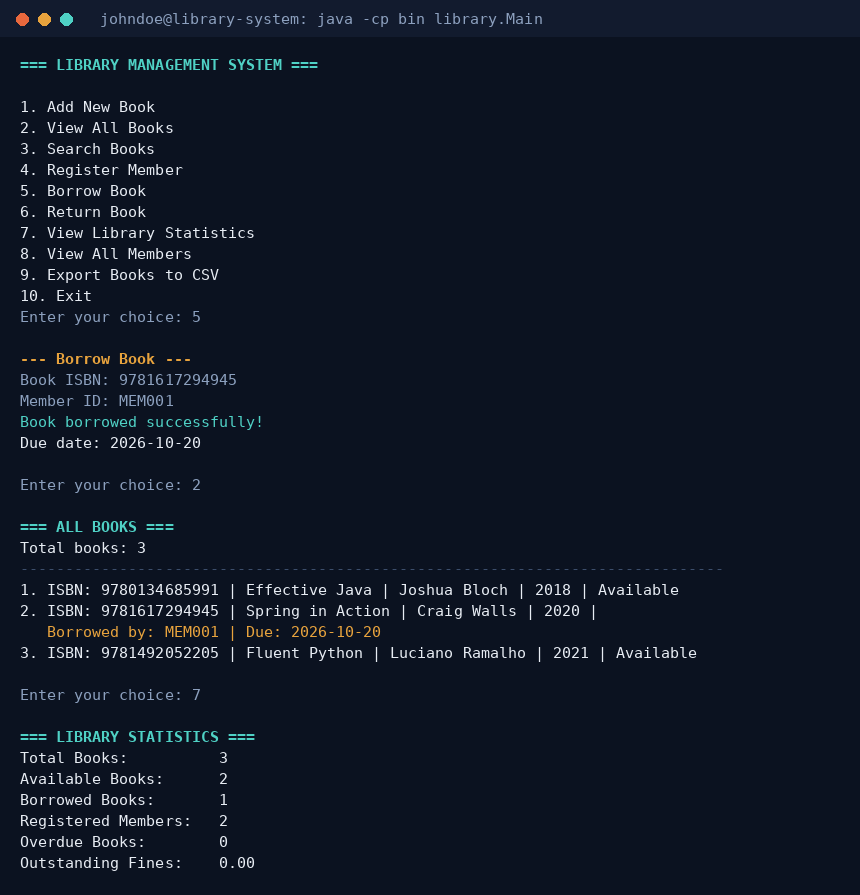
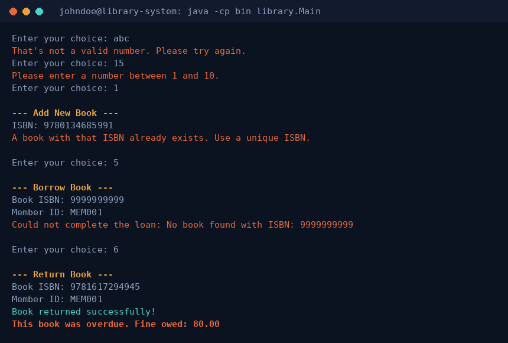

# Console-Based Library Management System

A Java console application for managing library operations including book tracking, member management, and borrowing with file-based data persistence. Built with core OOP principles as the Week 3: Java Programming Basics project for the Developers Arena course.



---

## 1. Project Overview

**Goal:** build a command-line library management system that lets a librarian manage books, members, and borrowing operations, using proper OOP design and file-based persistence — no database, no GUI — per the Week 3 brief.

**What it includes:**
- Add, remove, and search for books by title, author, or ISBN
- Register library members
- Borrow and return books with automatic due-date tracking (14-day loan period)
- Overdue fine calculation
- File-based persistence (`data/books.txt`, `data/members.txt`) that survives program restarts
- Library-wide statistics (totals, availability, overdue count, outstanding fines)
- CSV export of the book catalog
- A console menu with input validation at every step

## 2. Setup & Installation Instructions

**Requirements:** JDK 17 or later. ([Download here](https://adoptium.net/) if you don't have it — check with `java -version`.)

### Option A — Plain `javac` / `java` (no Maven needed)
```bash
git clone https://github.com/Md-Kaif534/week3-library-system.git
cd week3-library-system

# Compile
javac -d bin src/main/java/library/*.java

# Run
java -cp bin library.Main
```

### Option B — Maven
A `pom.xml` is included for anyone who prefers Maven.
```bash
mvn compile
mvn exec:java

# or build a runnable jar
mvn package
java -jar target/library-system.jar
```

Either way, the program creates `data/books.txt` and `data/members.txt` automatically on first run if they don't already exist, so there's nothing to set up by hand.

## 3. Code Structure

```
week3-library-system/
|-- src/main/java/library/
|   |-- Main.java                     # Console menu loop, Scanner input, validation
|   |-- Book.java                     # Book entity: fields, behavior, file (de)serialization
|   |-- Member.java                   # Member entity: fields, borrowed-book tracking
|   |-- Library.java                  # Facade: owns the collections, all business logic
|   |-- FileHandler.java              # The only class that touches books.txt / members.txt
|   |-- BookNotFoundException.java    # Thrown when an ISBN doesn't exist
|   |-- MemberNotFoundException.java  # Thrown when a member ID doesn't exist
|   `-- BookUnavailableException.java # Thrown when borrowing an already-borrowed book
|-- src/main/resources/               # (reserved for future config/resource files)
|-- data/
|   |-- books.txt                     # Persisted book catalog (pipe-delimited)
|   `-- members.txt                   # Persisted member list (pipe-delimited)
|-- docs/                             # Screenshots used in this README
|-- README.md
|-- .gitignore
`-- pom.xml
```

**Why this split?**
- **Main** only talks to the user (prompts, menus, input validation) and never touches a file or a collection directly — it calls into `Library` for everything.
- **Library** is a facade: it owns the `List<Book>` and `List<Member>`, and is the only class with business rules (loan periods, fine calculation, duplicate checks).
- **FileHandler** is the only class that opens a file. If this project later moved to a real database, this is the one file that would change.
- **Book** and **Member** are plain entity classes with private fields and public getters/setters (encapsulation), plus their own `toFileLine()` / `fromFileLine()` methods so each class owns its own serialization format.
- Three small custom exceptions (`BookNotFoundException`, `MemberNotFoundException`, `BookUnavailableException`) replace generic error strings with typed, catchable failures — `Main` catches them and prints a friendly message instead of crashing.

## 4. Visual Documentation

**Sample session** — adding books, registering a member, borrowing a book, and viewing statistics:


**Input validation and error handling** — invalid menu input, duplicate ISBN, borrowing a non-existent book, and an overdue return with a calculated fine:



## 5. Technical Details

**Class design (encapsulation)**
- `Book` and `Member` keep every field `private`; all access goes through getters/setters, so internal representation (e.g. how a due date is stored) can change without touching any other class.
- `Member.getBorrowedIsbns()` returns `Collections.unmodifiableList(...)` — callers can read a member's borrowed books but can't mutate the list directly; they must go through `borrowBook()` / `returnBook()`, which keeps the Book and Member records from drifting out of sync.

**Data structures**
- Books and members are stored in `ArrayList<Book>` / `ArrayList<Member>` inside `Library` — the natural fit for an ordered, resizable collection where ISBN/ID lookups are done with a linear scan (fine at this scale; a `Map<String, Book>` would be the next optimization for a much larger catalog).
- Each `Member` keeps its own `List<String>` of borrowed ISBNs rather than scanning every `Book` to answer "what has this member borrowed" — a direct space/time trade-off in the member's favor.
- Java Streams (`stream().filter().collect()`, `.count()`, `.mapToDouble().sum()`) power search, statistics, and fine totals instead of hand-written loops — e.g. `searchBooks()` filters on title, author, or ISBN in one pass.

**File I/O & persistence**
- Each `Book` / `Member` serializes itself to one pipe-delimited line (`toFileLine()`) and parses itself back (`fromFileLine()`), so the file format lives next to the class it describes.
- `FileHandler` wraps every read/write in `try-with-resources` + `try/catch(IOException)`, so a missing or unreadable file degrades to an empty list with a warning instead of crashing the program.
- A malformed line in `books.txt`/`members.txt` is skipped with a line-number warning rather than aborting the entire load — one bad row can't take down the whole catalog.
- Every mutating `Library` method (`addBook`, `borrowBook`, `returnBook`, …) saves immediately, so at most the very last unsaved action is lost if the program exits unexpectedly.

**Exception handling**
- Three checked exceptions (`BookNotFoundException`, `MemberNotFoundException`, `BookUnavailableException`) model the specific ways a borrow/return can fail. `Main` catches them at the point of use and prints the exception's own message — no raw stack traces reach the user.
- Input parsing (`Integer.parseInt`) is wrapped in `try/catch(NumberFormatException)` inside a loop, so a non-numeric menu choice just re-prompts instead of crashing.

**Algorithms**
- **Overdue fine** — a flat linear model: `ChronoUnit.DAYS.between(dueDate, today) * FINE_PER_DAY`, computed lazily whenever it's asked for (on display, on return) rather than stored, so it's always correct relative to "now."
- **Search** — case-insensitive substring match (`String.contains`) over title, author, and ISBN, combined with Streams into a single filter pass.

## 6. Testing Evidence

Manual test cases run during development (see the screenshots above for several of these):

| Test case | Steps | Expected result | Result |
|---|---|---|---|
| Add book | Choice 1, enter a new ISBN | Book added, confirmation printed, saved to books.txt | ✅ Pass |
| Duplicate ISBN | Choice 1, enter an ISBN already in use | Rejected with a clear message, no duplicate created | ✅ Pass |
| Invalid menu input | Enter "abc" or "15" at the menu | Re-prompted with a specific error, no crash | ✅ Pass |
| Register member | Choice 4, valid name/email | Member registered and saved to members.txt | ✅ Pass |
| Invalid email | Choice 4, enter "not-an-email" | Rejected, re-prompted until a valid shape is entered | ✅ Pass |
| Borrow book | Choice 5, valid ISBN + member ID | Book marked unavailable, due date set to +14 days | ✅ Pass |
| Borrow unknown book/member | Choice 5, a non-existent ISBN or ID | `BookNotFoundException` / `MemberNotFoundException` caught, friendly message shown | ✅ Pass |
| Borrow already-borrowed book | Choice 5 on a book someone else has | `BookUnavailableException` caught, message names the book | ✅ Pass |
| Return + fine | Choice 6, on a book with a past due date | Book made available again, fine computed and printed | ✅ Pass |
| Persistence across restart | Add data, exit, relaunch the program | "Loaded N books and M members" matches what was saved | ✅ Pass |
| Statistics | Choice 7 | Totals, availability, overdue count, and fines all match the current data | ✅ Pass |
| CSV export | Choice 9, a file path | A valid CSV is written with all current book data | ✅ Pass |
| Malformed data line | Manually corrupt one line in books.txt, relaunch | That line is skipped with a warning; the rest of the file still loads | ✅ Pass |

**How to re-run these yourself:** launch the program and follow the menu — every case above is just a sequence of menu choices, so they can be repeated exactly as described.

**Suggested pre-submission checklist:**
- [ ] Confirm `java -version` shows 17+ before compiling
- [ ] Run through the sample menu flow at least once end-to-end (add → borrow → return → statistics)
- [ ] Open `data/books.txt` after a run to confirm it persisted correctly
- [ ] Push to GitHub with the `data/` folder included (even if the `.txt` files are empty) so the required structure matches

---

## Features
- Add, remove, and search for books
- Register and manage library members
- Borrow and return books with due dates
- Calculate overdue fines
- File-based data persistence
- Comprehensive input validation
- Library statistics generation
- CSV export of the book catalog

## How to Run
```bash
# Compile and run
javac -d bin src/main/java/library/*.java
java -cp bin library.Main
```

## Sample Menu
```
=== LIBRARY MANAGEMENT SYSTEM ===
1. Add New Book
2. View All Books
3. Search Books
4. Register Member
5. Borrow Book
6. Return Book
7. View Library Statistics
8. View All Members
9. Export Books to CSV
10. Exit

Enter your choice:
```

## Technologies Used
- Java 17+ (classes, interfaces, Streams, exceptions, `java.time`)
- File I/O (`java.io`, `java.nio.file`)
- Maven (optional build/run wrapper — `pom.xml` included)
- Git for version control
